# Практика 8. Публикуем модель из Google Colab

## Что получится

Вы создадите отдельную веб-страницу с формой. Посетитель введёт признаки пассажира и получит прогноз модели, которая выполняется в вашей среде Colab. Доступ к самому блокноту посетителю не нужен.

Путь занятия: одна модель → сохранённый Pipeline → приложение Gradio → публичная ссылка → проверка с другим человеком → остановка сервера.

[Открыть блокнот в Colab](https://colab.research.google.com/github/rustam-azimov/ml-course-hse/blob/main/practice/practice08_publish_model.ipynb). [Скачать исходный блокнот](practice08_publish_model.ipynb).

Нужны Google-аккаунт, браузер, интернет и второй браузер или телефон для проверки. GPU, платная подписка и токены не требуются. Все ячейки основного маршрута заполнены: задача занятия — понять и проверить публикацию модели.

Скриншоты получены при выполнении этой практики в браузере 8 ноября 2026 года. В показанном запуске получены ROC-AUC 0.822 и контрольная вероятность 0.9975. В вашем окружении последние цифры могут отличаться. Адрес gradio.live на скриншотах относится к завершённому запуску и уже остановлен: используйте адрес из своего вывода.

## 1. Откройте свою копию блокнота

1. Перейдите по ссылке на Colab и войдите в Google, если потребуется.
2. В меню **Файл → Сохранить копию на Диске** создайте свою копию. Проверьте, что открылась копия, а не общий блокнот преподавателя. Можно переименовать её, добавив фамилию.
3. Если у вас файл `.ipynb`, откройте [Colab](https://colab.research.google.com/) и выберите **Файл → Загрузить блокнот**.

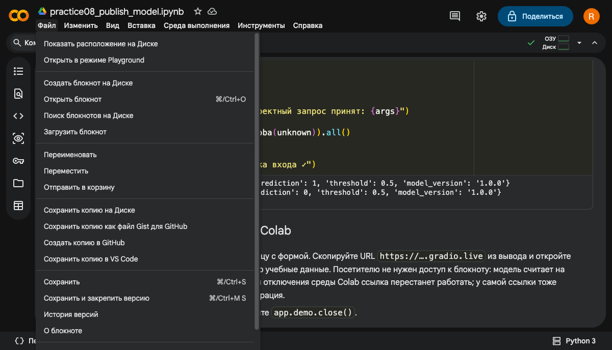

На скриншоте нужный пункт находится между «Отправить в корзину» и вариантами сохранения копии в другие сервисы. Кнопка «Поделиться» здесь не нужна: позже вы передадите ссылку на форму.

Прочитайте вводную ячейку. Она описывает маршрут и ограничение временной публикации.

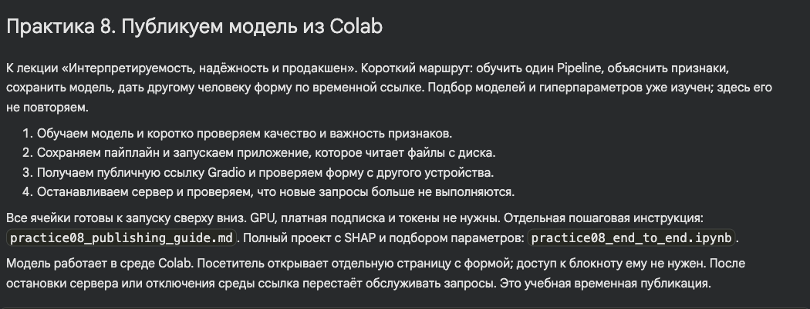

**Результат шага:** у вас есть собственный редактируемый блокнот.

## 2. Подключите среду и установите Gradio

1. Нажмите **Подключиться** справа вверху. После подключения появятся индикаторы ОЗУ и диска.
2. Если выбираете тип среды, оставьте Python 3 и CPU. Ускоритель GPU этой модели не нужен.
3. Запустите первую кодовую ячейку кнопкой с треугольником слева:

   ```python
   %pip install -q gradio==6.0.1 shap==0.51.0
   ```

4. Дождитесь завершения. Пока выполняется ячейка, не запускайте её повторно. В дальнейшем запускайте ячейки последовательно сверху вниз; можно использовать `Shift+Enter`.

В проверенном Colab установщик напечатал предупреждения о несовместимых зависимостях предустановленных `google-adk`, `google-genai` и `python-fasthtml`. В этой практике они не используются; дальнейшие ячейки и публичный прогноз прошли проверку. Если у вас возникает `Traceback`, ошибка импорта Gradio или не завершается установка, остановитесь и покажите преподавателю полный вывод. Красный текст сам по себе не подтверждает ни успех, ни провал всей практики: ориентируйтесь на последующие проверки.

**Результат шага:** среда подключена, установочная ячейка завершена.

## 3. Обучите модель и прочитайте оценку качества

Запустите код раздела **1. Обучаем один пайплайн**. Он загрузит открытые данные Titanic и возьмёт четыре признака:

| Поле | Смысл | Пример |
|---|---|---|
| `age` | Возраст в годах | `30` |
| `fare` | Стоимость билета в единицах исходного датасета | `100` |
| `sex` | Категория пола в данных | `female` или `male` |
| `pclass` | Класс билета | `1`, `2` или `3` |

Внутри Pipeline находятся заполнение пропусков, кодирование категорий и случайный лес. Предобработка обучается на тренировочной части. Модель проверяется на отложенных данных.

В выполненном запуске получено:

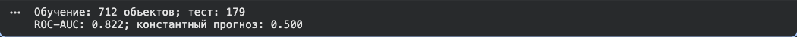

- 712 объектов в обучении и 179 в тесте.
- ROC-AUC — 0.822, выше константного прогноза с ROC-AUC 0.5.
- Порог принятия решения заранее установлен в 0.5. В этой демонстрации его не подбираем.

ROC-AUC 0.822 не означает, что «82.2% пассажиров классифицированы правильно». Это метрика ранжирования. После просмотра теста не меняйте модель ради улучшения этой цифры.

Запустите раздел **2. Что использует модель**. Таблица показывает, насколько падает ROC-AUC при перемешивании каждого исходного признака. В выполненном примере наибольшее падение было у `sex`, затем у `pclass`. Назовите первый признак в своей таблице и объясните, как получена его важность. Эта проверка не доказывает причинное влияние признака.

### Запустите SHAP для одного пассажира

После таблицы выполните готовую ячейку **2.1. SHAP: объясняем один прогноз**. Она использует уже обученную модель: повторное обучение не требуется. Если Gradio установлен ранее, отдельно выполните `%pip install -q shap==0.51.0`.

Ячейка берёт пассажирку 30 лет, стоимость билета 8, третий класс, применяет сохранённую предобработку и строит `shap.plots.waterfall`. Индекс `[0, :, 1]` выбирает первого пассажира и класс «выжил». Два one-hot столбца пола объединяются в один исходный признак.

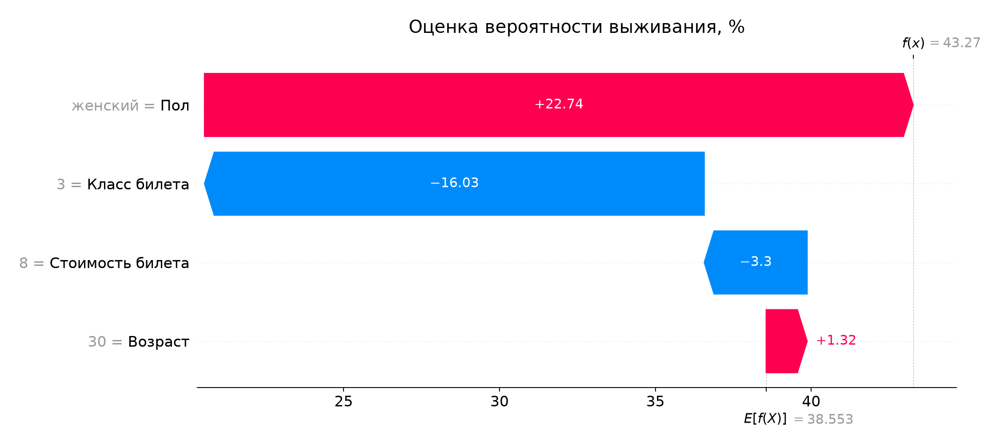

Читайте снизу вверх: E[f(X)] — средний прогноз на 100 фоновых обучающих примерах (около 38.6%); красные вклады повышают оценку, синие понижают. f(x) — итог для пассажирки (около 43.3%). На графике вклад +22.7 означает +22.7 процентного пункта. Проверка в коде подтверждает совпадение суммы с `predict_proba`. Вклады объясняют модель и не доказывают причинность.

**Результат шага:** модель обучена, таблица важности и график SHAP построены.

## 4. Сохраните пайплайн и создайте приложение

Выполните разделы **3. Сохраняем и восстанавливаем** и **4. Создаём отдельное приложение**.

Первая ячейка сохраняет Pipeline, загружает его обратно и сравнивает вероятности с исходными. Должна появиться строка:

```text
Прогноз после загрузки совпадает с исходным ✓
```

В каталоге `titanic_demo` создаются четыре файла:

| Файл | Что в нём |
|---|---|
| `model.joblib` | Pipeline с обученной предобработкой и классификатором |
| `metadata.json` | Порог, версия модели, метрика, источник и хэш данных, версии библиотек |
| `app.py` | Форма Gradio и функция обработки запроса |
| `README.md` | Назначение, качество и ограничения модели |

Файлы можно посмотреть через значок папки слева в Colab. Отдельно скачивать или куда-либо загружать их для публикации в этой практике не нужно. Они находятся на временном диске среды и могут исчезнуть после её удаления.

В коде приложения найдите три места:

1. `joblib.load(...)` — загружается сохранённый Pipeline.
2. `predict(...)` — проверяются входные значения и вызывается `predict_proba`.
3. `gr.Interface(...)` — задаются четыре поля формы и формат результата.

Приложение не обучает модель при каждом запросе. Оно использует сохранённую предобработку, поэтому не нужно вручную дублировать импьютер и кодировщик. Загружайте через joblib только собственные или доверенные файлы: при загрузке может выполняться код.

**Результат шага:** прогноз после загрузки совпал, четыре файла приложения созданы.

## 5. Проверьте приложение до публикации

Запустите раздел **5. Проверяем приложение до публикации**. Ячейка импортирует записанный `app.py`, проверяет обычный запрос, пропущенный возраст и отклонение неверных значений.

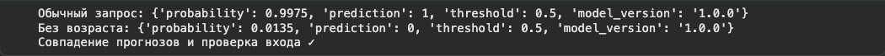

В выполненном запуске обычный запрос `30, 100, female, 1` вернул:

```json
{
  "probability": 0.9975,
  "prediction": 1,
  "threshold": 0.5,
  "model_version": "1.0.0"
}
```

| Поле ответа | Как читать |
|---|---|
| `probability` | Оценка вероятности класса «выжил» |
| `prediction` | `1` при вероятности не ниже порога, иначе `0` |
| `threshold` | Сохранённый порог системы |
| `model_version` | Версия модели, обслужившей запрос |

Проверка «Без возраста» в блокноте использует другой набор: пустой возраст, стоимость `8`, пол `male`, класс `3`. Поэтому её вероятность 0.0135 не нужно сравнивать с формой, где вы очистили только возраст у пассажира `female, 1`.

**Результат шага:** появилась строка «Совпадение прогнозов и проверка входа ✓». При ошибке до публикации не переходите.

## 6. Запустите форму и получите публичную ссылку

В разделе **6. Публикуем временную ссылку из Colab** выполните:

```python
app.demo.launch(share=True, debug=False, prevent_thread_lock=True)
```

- `share=True` создаёт публичный адрес к серверу в Colab.
- `debug=False` не включает блокирующий отладочный режим.
- `prevent_thread_lock=True` позволяет выполнить следующую ячейку, пока сервер продолжает работать.

Найдите в выводе строку **Running on public URL** и скопируйте адрес `https://….gradio.live`.

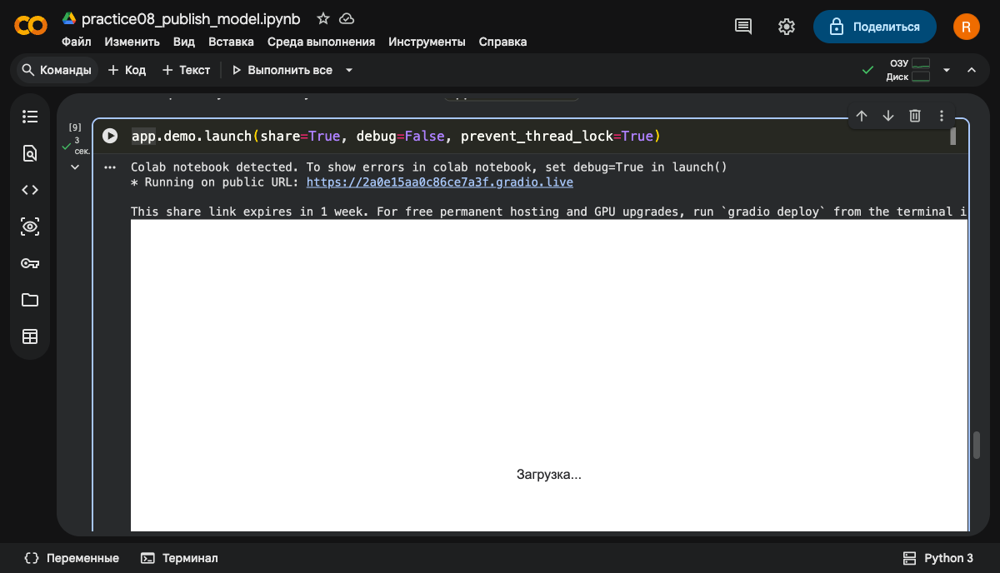

Используйте свой адрес. Не отправляйте ссылку на блокнот и адрес `127.0.0.1`. Если встроенная форма под ячейкой остаётся на «Загрузка…», откройте публичную ссылку отдельно: в проверенном запуске этот способ работал.

Вывод Gradio может предлагать другие способы хостинга. Они не входят в эту практику: дополнительных аккаунтов, подписок и команд `deploy` не требуется. Указанный Gradio предел жизни ссылки не гарантирует столько же времени работы Colab.

**Результат шага:** появился публичный URL.

## 7. Получите прогноз в отдельном браузере

1. Откройте публичный URL в другом браузере или на телефоне.
2. Убедитесь, что открылась страница «Титаник: учебная модель» с четырьмя полями.
3. Введите возраст `30`, стоимость `100`, пол `female`, класс `1`.
4. Нажмите **Submit**. Сравните все четыре поля ответа с «Обычный запрос» в блокноте.

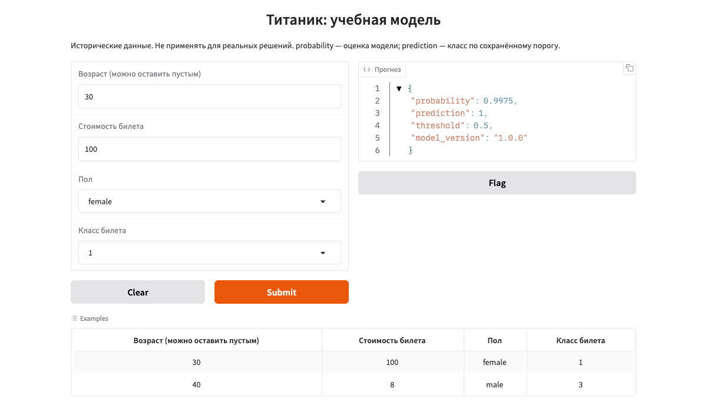

В выполненном запуске публичная форма вернула 0.9975 — то же значение, что функция в блокноте.

Запрос идёт по цепочке:

```text
Браузер посетителя → публичный адрес Gradio → сервер в Colab
                  → сохранённый Pipeline → ответ в браузер
```

Доступ к коду и Google-аккаунту владельца посетителю не требуется. Ссылка общедоступна: вводите только учебные данные. Это историческая модель одного события 1912 года; её вероятности не калиброваны и не предназначены для реальных решений о людях.

**Результат шага:** новый запрос выполнен вне страницы блокнота и совпал с контрольным ответом.

## 8. Проверьте пропуск и неверный ввод

### Пустой возраст

Очистите только возраст. Оставьте стоимость `100`, пол `female`, класс `1`. Снова нажмите **Submit**.

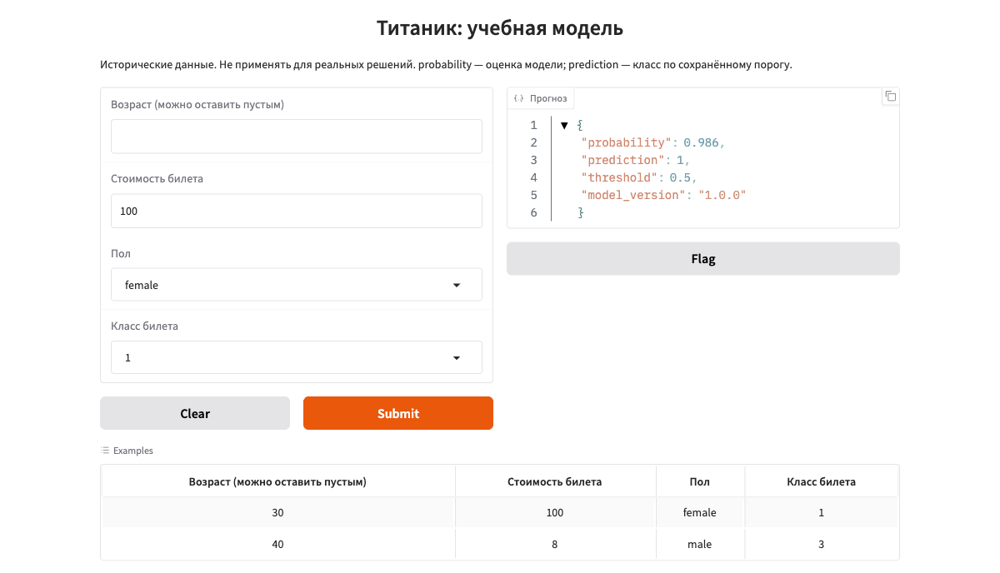

В проверенном запуске получено 0.986. Пустое поле передаётся как пропуск; обученный импьютер внутри Pipeline подставляет медиану. Прогноз не обязан совпадать с ответом для возраста 30.

### Отрицательный возраст

Введите `-1` в возраст и снова нажмите **Submit**.

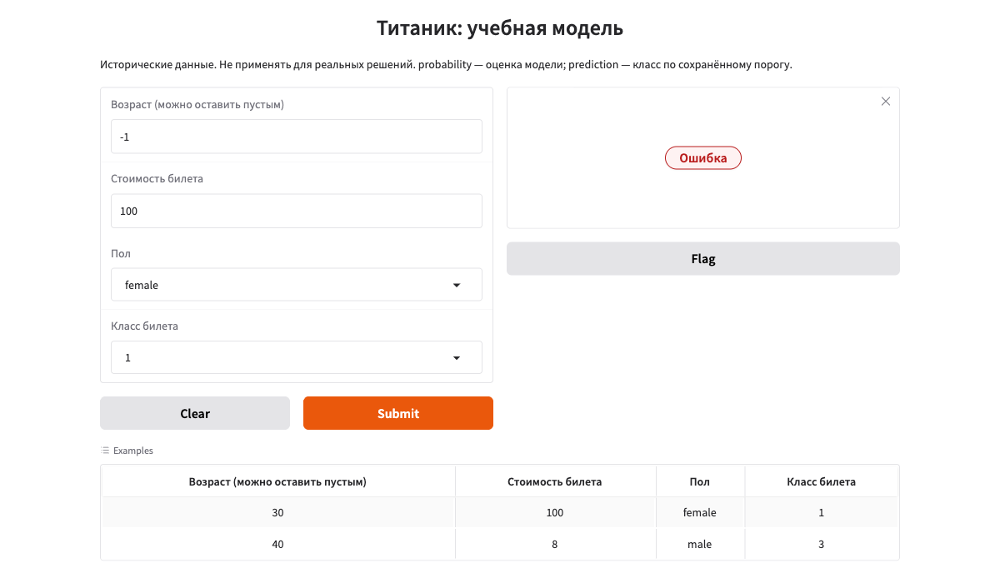

Форма показывает ошибку вместо нового прогноза. Код `predict` отклоняет такой ввод до обращения к модели. Сообщение с пояснением может появляться кратковременно; область результата показывает «Ошибка».

Верните возраст `30` и убедитесь, что нормальный запрос снова выполняется. Затем передайте ссылку одногруппнику: он должен получить новый прогноз со своего устройства. Не меняйте права доступа к самому блокноту.

**Результат шага:** пропуск обрабатывается, некорректное значение отклоняется, другой человек может пользоваться формой.

## 9. Остановите сервер и проверьте ссылку

После проверки одногруппником вернитесь в Colab.

1. Нажмите **Код**, чтобы добавить кодовую ячейку. Убедитесь, что вводите команду в новую ячейку, не заменяя код обучения.
2. Введите и выполните:

   ```python
   app.demo.close()
   ```

3. В выводе появляется `Closing server running on port: 7860`; номер порта у вас может отличаться.

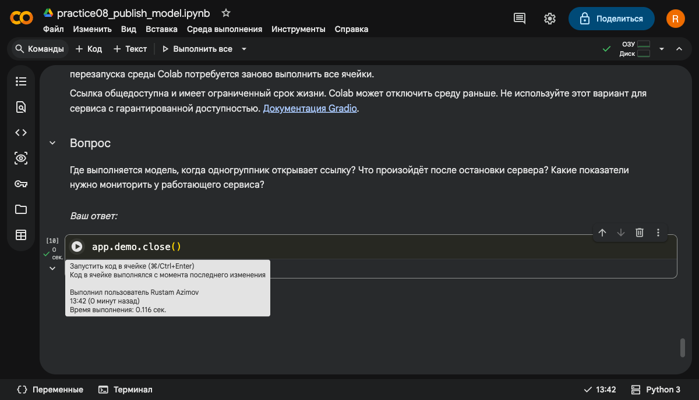

4. Обновите публичную страницу или откройте адрес в новой вкладке. В выполненном запуске он вернул HTTP 404 и сообщение **No interface is running**.

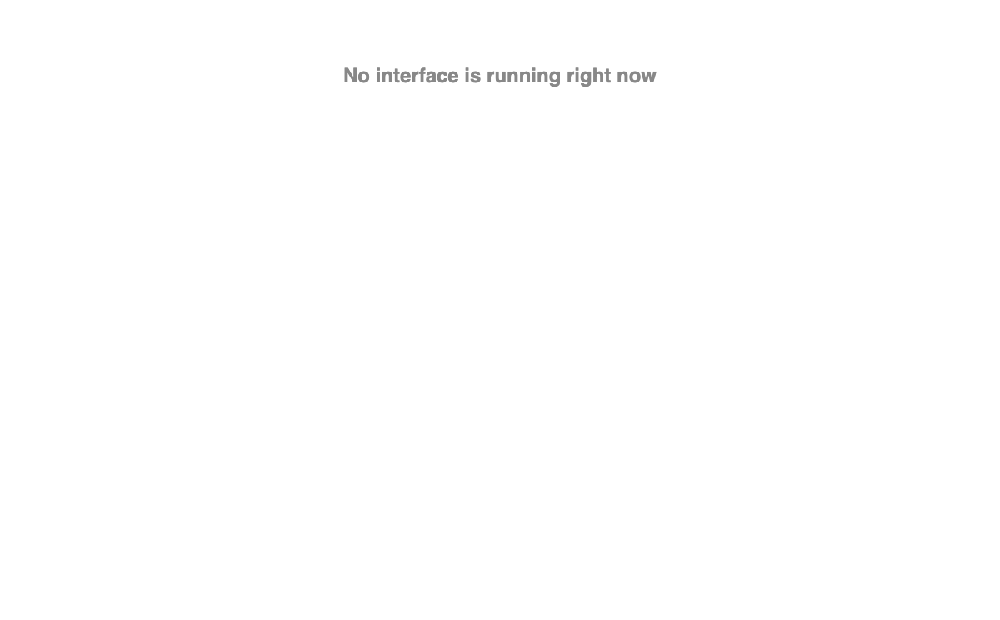

Старый прогноз может оставаться на уже открытой странице — это сохранённое содержимое браузера. Проверять нужно новый запрос или новую загрузку страницы.

Команда остановки намеренно не включена в готовые кодовые ячейки: автоматический запуск блокнота не должен закрывать сервер сразу после публикации. Если добавили её, перед повторным «Выполнить все» удалите эту ячейку или не запускайте её автоматически.

Для повторного показа выполните раздел 6 и используйте актуальный адрес из вывода. После перезапуска или удаления среды Colab выполните весь маршрут заново.

**Результат шага:** вы увидели, что доступность формы зависит от работающего сервера в Colab.

## Если что-то не работает

| Симптом | Действия |
|---|---|
| Colab просит вход | Войдите в свой Google-аккаунт; затем вернитесь к своей копии блокнота. |
| `NameError` | Пропущена предыдущая ячейка или среда была перезапущена. Выполните подготовку по порядку. |
| `ModuleNotFoundError` | Повторите установочную ячейку и прочитайте полный вывод. Если импорт не проходит, обратитесь к преподавателю. |
| `FileNotFoundError` | Заново выполните сохранение модели и создание `app.py` в текущей среде. |
| Нет публичного URL | Прочитайте ошибку запуска. Проверьте подключение среды. Если сервер уже работал, выполните `app.demo.close()` и повторите раздел 6. |
| Встроенная форма бесконечно загружается | Откройте публичную ссылку в отдельной вкладке. Если и она не работает, проверьте сеть и вывод сервера. |
| Ссылка перестала работать | Убедитесь, что среда подключена и сервер не остановлен. После повторного запуска используйте актуальную ссылку. |
| Вероятности различаются | Сверьте все четыре поля, версию модели и запуск обучения. Пустой возраст и возраст 30 — разные входы. |
| Туннель блокируется сетью | Сообщите преподавателю; при наличии разрешённой альтернативной сети проверьте её. Локальный прогноз сам по себе не доказывает публичную доступность. |

## Что сдать или показать

1. Контрольный ответ в блокноте и такой же ответ в публичной форме.
2. Результат нового запроса с устройства одногруппника.
3. Прогноз при пустом возрасте и ошибку при возрасте `-1`.
4. Скриншот остановки и результат повторного открытия ссылки.
5. Три коротких ответа: где считает модель; почему посетителю не нужен блокнот; что нужно мониторить у работающего сервиса.

Если сеть не позволила проверить публичную ссылку, укажите это явно. Приложите вывод запуска и успешные проверки раздела 5, не выдавая локальную проверку за сетевую.

Связь с лекцией: важность признаков помогает понять модель; сохранённый Pipeline удерживает одинаковую предобработку в обучении и сервисе; карточка фиксирует ограничения; запуск и остановка показывают зависимость сервиса от инфраструктуры. Мониторинг ошибок, задержки, пропусков, распределений данных и качества в этой демонстрации не реализован.
